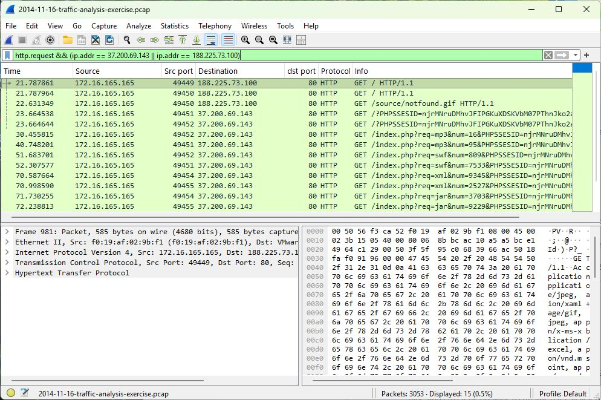

# Lab 1 - Where did the suspicious downloads come from?

I started with the HTTP requests, then worked backwards through DNS and checked the client's identity. The six questions below guided the investigation.

## 1. Which suspicious files were downloaded, and what are their hashes?

I found a **Flash file** and a **Java archive** served by the same download host:

- Flash, requested with `req=swf`: 8,227 bytes. MD5: `7b3baa7d6bb3720f369219789e38d6ab`.
- Java archive, requested with `req=jar`: 10,606 bytes. MD5: `1e34fdebbf655cebea78b45e43520ddf`.

In Wireshark, `http.request` shows the download requests. The responses at packets **2394** and **2489** identify the file types and link back to those requests. The HTTP Objects window is also useful for listing these transfers.

Another body, **401,811 bytes**, was delivered three times. Its MD5 is `d276c86dcdbcdb6b74ee02496bc90d98`. The recovered bytes are opaque, so I have not described this as a decoded Windows executable or assumed it was harmless.

The hashes were calculated during offline analysis. [Full SHA-256 values](../../docs/hashes.md) are kept separately so they do not interrupt the explanation.

**VirusTotal:** the next step is to compare the Flash and Java hashes with existing reports. [The lookup notes and direct links are here](evidence/virustotal.md). Live results and new VirusTotal screenshots could not be verified in this session, so no detection count or antivirus verdict is claimed.

## 2. What was the malicious website's domain?

The download host was **stand.trustandprobaterealty.com**.

There is an important distinction: the browsing chain began at **www.ciniholland.nl**, passed through **24corp-shop.com**, and then reached the download host. The initial site and the server delivering the suspicious files had different roles.

I used `http.request` to read the Host and request path, then checked the relevant TCP streams. The returned pages at packets **318** and **1074** explain the redirects; the landing requests appear at **1212–1213**. The captured scripts are not included in this project.

## 3. What was the website's IP address?

**37.200.69.143** served the suspicious downloads. The initial website, www.ciniholland.nl, used **82.150.140.30**.

I compared the DNS answers with the destination IPs in the HTTP requests. DNS packet **1129** links the download domain to 37.200.69.143; packet **139** links the initial website to 82.150.140.30.

The filter keeps the relevant requests together. The source column identifies the client, while the destination and Info columns show where it went and what it requested.

## 4. Which computer was involved?

**172.16.165.165** is the client making the requests and receiving the suspicious files. It appears repeatedly in the screenshot above. I confirmed it against the original packets rather than treating every address in the capture as an infected computer.

## 5. What was its hostname?

**K34EN6W3N-PC**.

I checked DHCP traffic with `dhcp.option.hostname`. Packet **2442** contains the hostname in option 12. This gives the IP address a computer name that an analyst could search for in endpoint logs.

## 6. What was its MAC address?

**f0:19:af:02:9b:f1**.

I selected an outbound client packet, such as **161**, and expanded **Ethernet II** to read the source MAC. This identifies the local client interface visible in the capture.

### What I took from this lab

DNS, HTTP requests and DHCP answer different parts of the same question. Putting them together identifies the client and explains the download chain. The capture shows delivery of suspicious content; it does not by itself prove that the payload ran successfully. In a real investigation, I would check the identified computer in EDR and review its browser activity.
