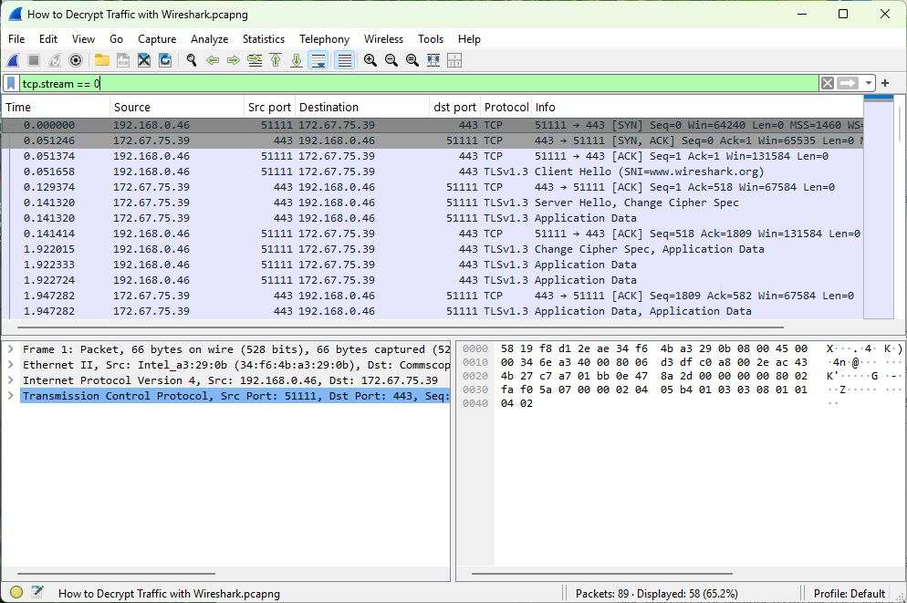
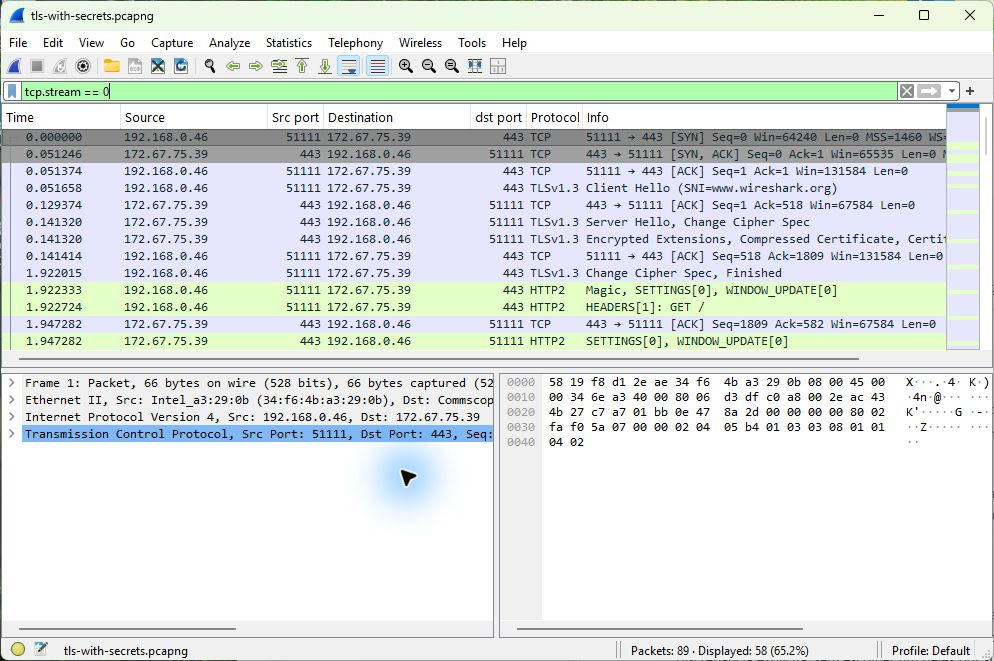

# Lab 2 - What changes when HTTPS is decrypted?

This lab compares the same connection before and after adding the supplied TLS key-log file. It is a visibility exercise, not a malware case.

## Before adding the keys

I filtered on `tcp.stream == 0` to keep one connection on screen. The client was **192.168.0.46**, connecting to **172.67.75.39** on port 443.

The ClientHello at packet **4** names **www.wireshark.org**. That tells me the requested hostname, but the later TLS Application Data does not reveal the HTTP request.

## After adding the keys

In **Edit → Preferences → Protocols → TLS**, the supplied sslkeylog.log can be selected under **(Pre)-Master-Secret log filename**. With matching keys, Wireshark can decode the application traffic.

The filter `http2` then shows a **GET /** request to www.wireshark.org at packet **11**, followed by **200 OK** at packet **20**.

For this screenshot, a private working copy contained the same supplied session secrets. That is why its filename differs. The packet numbers and connection are the same; neither the keys nor that working copy are bundled here.

## What I learned

Even without decryption, I can inspect addresses, ports and visible handshake information. Matching keys add the HTTP details that were previously hidden. They only work for the corresponding sessions; having a PCAP does not mean I can decrypt any HTTPS traffic.

This capture does not establish a compromised computer or a client hostname. Its purpose is to demonstrate the before-and-after difference clearly.
