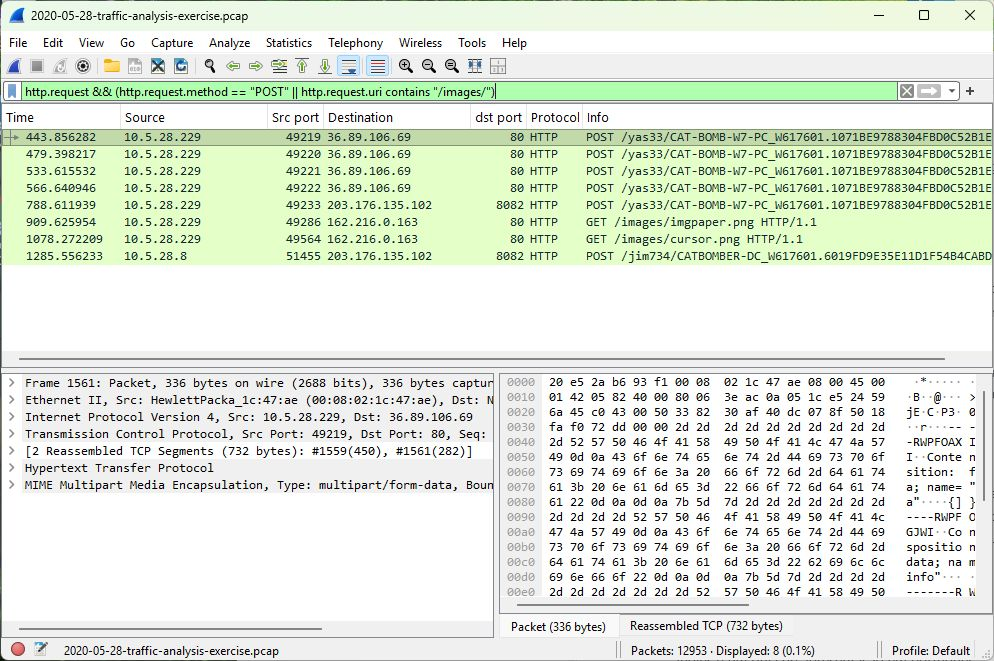
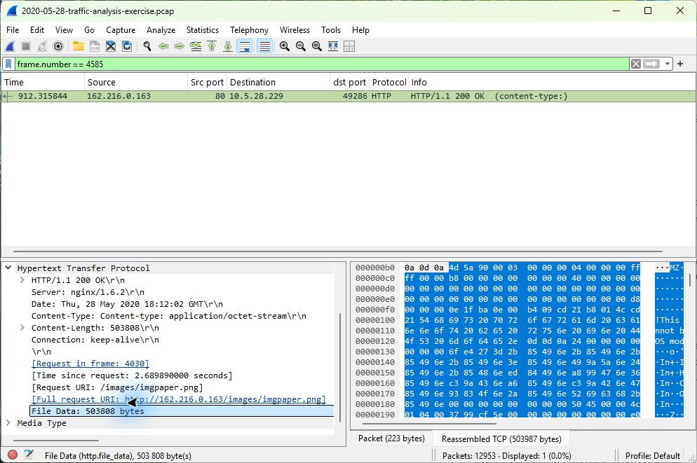
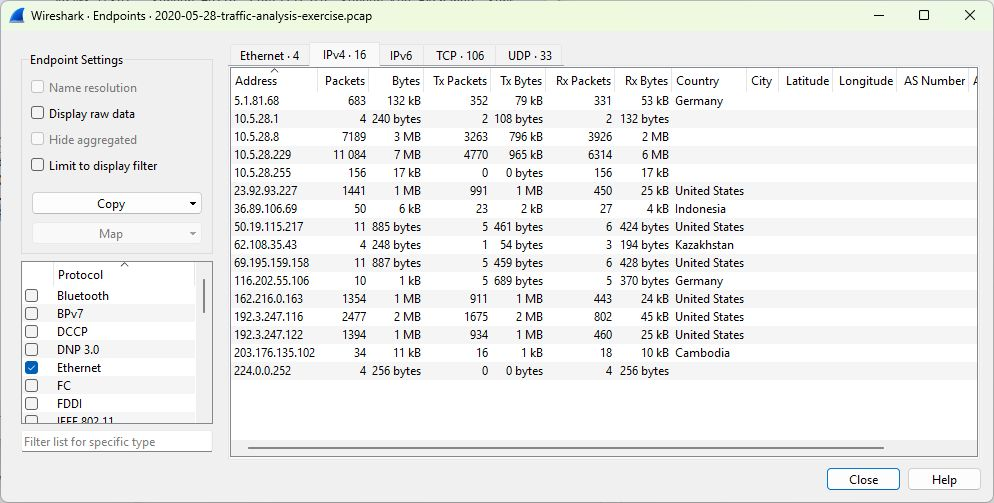

# Lab 3 - Following suspicious traffic to a domain controller

This exercise is described as a TrickBot infection by the original lab author. I focused on what the capture actually shows: the client identity, outbound requests, downloaded files and the domain controller's activity.

## Which computer was involved?

The affected Windows client was **10.5.28.229**, named **Cat-Bomb-W7-PC**, with user **phillip.ghent**.

I filtered on `http.request.method == "POST"` and checked the requests and their contents. Packet **2256** carries the client's hostname, user and network details to **203.176.135.102:8082**. This is more informative than identifying a busy IP address alone.

The visible request paths contain host identifiers. The final request comes from a different internal IP, which led me to investigate the domain controller too.

## What was downloaded?

The client requested **/images/imgpaper.png** and **/images/cursor.png** from **162.216.0.163**. Their names suggest images, but both recovered files were **503,808-byte Windows executables**.

I matched the requests to responses **4585** and **9771**, checked the reported length and inspected the file headers. The MZ and PE signatures support the executable identification. I did not run either file.

The screenshot shows the image-like request name, the file length and the MZ header. This is why I checked the actual contents rather than trusting the extension.

The two SHA-256 values are:

- imgpaper.png: `934c84524389ecfb3b1dfcb28f9697a2b52ea0ebcaa510469f0d2d9086bcc79a`
- cursor.png: `4e76d73f3b303e481036ada80c2eeba8db2f306cbc9323748560843c80b2fed1`

## Why did the domain controller matter?

The client communicated with **10.5.28.8** over SMB. I used **Statistics > Conversations** to review the connections, then checked DNS and the later HTTP traffic.

DNS packet **2380** identifies **CATBOMBER-DC.catbomber.net**. At **12886**, that host sends its own system and process information to the same external inventory destination. This is stronger evidence of DC involvement than simply seeing the client contact it.

The client MAC was **00:08:02:1c:47:ae**. For the DC, the MAC reported inside the inventory differs from the Ethernet source observed in the capture, so I have not presented either as an independently verified adapter address.

## Adding GeoIP context

I added the supplied GeoLite2-Country database and opened **Statistics > Endpoints > IPv4**. This made the destination countries visible next to the IPs.

The database places **162.216.0.163** in the United States and **203.176.135.102** in Cambodia. These are assignments from October 2026, while the capture is from 2020. They add context, not proof of the attacker's location.

## What I would check next

I would prioritise the client and domain controller, search for the same download hashes and outbound destinations, and investigate exposed credentials. The capture contains credential-related data, but no password is reproduced here. I would also check endpoint and authentication logs before naming a specific lateral-movement exploit.
