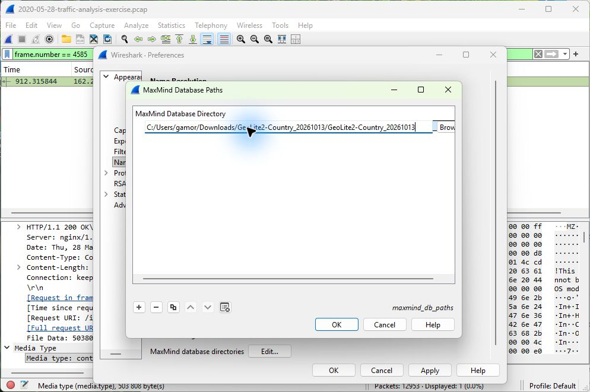

# Sources and a few lab notes

The project uses three independent training captures. The six questions in lab 1 follow the user's video worksheet. Findings come from the supplied captures; packet numbers allow the answers to be checked in the original files.

- [2014 traffic-analysis exercise](https://www.malware-traffic-analysis.net/2014/11/16/index.html)
- [2020 CATBOMBER / TrickBot exercise](https://www.malware-traffic-analysis.net/2020/05/28/index.html)
- [Wireshark TLS documentation](https://wiki.wireshark.org/TLS)
- [Wireshark GeoIP setup](https://www.wireshark.org/docs/wsug_html_chunked/ChMaxMindDbPaths.html)
- [VirusTotal hash searches](https://docs.virustotal.com/docs/searching)

### GeoIP

The user-supplied GeoLite2-Country database was built on **13 October 2026**. It returned countries for **20 of 21** public endpoints. The TLS endpoint returned no country; ASN and city require different databases.

Database SHA-256: `7ce2f6f453ee36dfd154b3eb1f7e1b8f7ea0248cb655bf25a39d7bfa86c4abe0`.

### Reading the screenshots

The Wireshark packet-list times are relative to the beginning of each capture. The TLS after-image uses a private copy with the supplied secrets embedded; those secrets are not part of this project. Screenshots were captured from the actual application.

### What is included

Short explanations, hashes and screenshots. No executable samples, captured scripts, packet dumps, passwords, session keys or original PCAPs are bundled. Files were not executed or uploaded to VirusTotal. Live VirusTotal results remain unverified, as explained in the lookup note.
